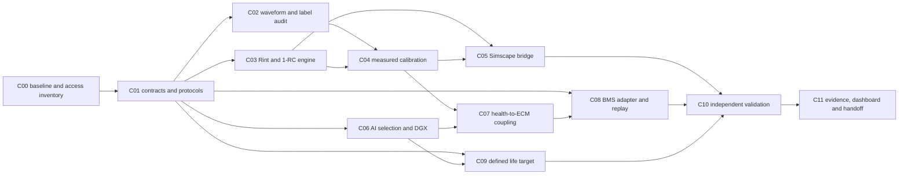

# Codex implementation plan: finish the missing proposal requirements

Execution policy updated 5 November 2026: **finish as soon as dependencies permit;
no calendar timeline or Gantt dates govern this work**. Local execution began on
5 November: the [results and remaining gates](implementation_results.md) record
completed runs and software-only evidence. Verify those artifacts before repeating
work. This handoff expands the requirements
in [proposal alignment](proposal_alignment_plan.md), phases 21-28. The earlier
evidence-dependent goal remains paused; writing this plan does not resume it.

## Run contract for Codex

Work from the repository root. Read applicable AGENTS/RTK instructions, this plan,
the proposal-alignment definitions and current `docs/phase_status.md`. Follow
Ponytail: reuse existing code and dependencies; complete working vertical slices.
Use `rtk` for shell commands. Do not add a workflow service, database, AutoML
framework, generic device registry or live control system for this work.

- Inspect Git status first. Preserve unrelated user edits, including the three
  notebooks and local Gantt PDF. Stage only explicit task paths.
- Preserve existing raw data, SOH reference, folds, protocols and completed runs.
  Write new studies to versioned paths and refuse to overwrite completed outputs.
- Mark software completion and scientific evidence separately. Use `planned`,
  `in_progress`, `software_verified`, `evidence_verified`, `waiting_external` or
  `failed_gate` in the existing phase tracker, with an evidence path and next action.
  Status labels are documentation, not a new orchestration system.
- A failed scientific comparison is a result, not permission to tune on its test
  set. Synthetic tests prove software behavior, not physical validation.
- Finish all independent work before stopping for a dependency. Record a single
  consolidated request for the exact missing data/access/definition. Retry only
  after a relevant change; do not repeatedly poll authors or retrain unchanged runs.
- Keep SOL undefined until confirmed. A separate explicitly named RUL experiment
  may be prepared; it does not automatically satisfy the proposal's SOL objective.
- Numerical scientific acceptance limits must be fixed before scored comparisons.
  Missing limits do not block parsers, analytic tests or interface implementation,
  but they prevent a claim that proposal performance targets have been met.

## Shortest path and dependency graph

Start C00-C01, then prioritize a measured-data electrical-model slice: audit one
eligible cell/session, implement Rint/1-RC, fit using permitted data, and predict
an untouched dynamic segment. Scale only after that slice passes its checks.
Do not wait for Simscape, DGX or actual BMS records to implement and test the
independent local components. Do not represent an unavailable runtime as executed.



Arrows govern final integration, not all preparation. C05 source/export tests can
start with fixed analytic cases before C04. C06 reuses eligible health data without
waiting for C04/C05. C08 can develop its reader/fault handling before C07. C09 can
audit events/censoring before C06. C10 validates each ready component separately;
C11 may display verified partial results without implying full completion.
Parallel branches describe independent work; one Codex session can interleave
them. This plan does not require subagents or concurrent edits to shared files.

## Work packages

### C00 - Baseline, resources and restart point (phase 21)

Read `pyproject.toml`, current configs and result provenance. Record the starting
Git revision and dirty paths. Run the existing checks below once; investigate any
baseline failure before attributing it to new changes. Inspect only authorized
local MATLAB/product and GPU availability. Record remote DGX access only when
an actual host/allocation is supplied; do not assume it exists.

Current planning inspection found no `matlab` or `nvidia-smi` on PATH and no
`MATLAB*` application under `/Applications`. This is not a license audit or proof
that remote access is unavailable. Recheck when executing, without installing or
reserving resources merely to write a plan.

**Done:** reproducible baseline, available inputs/tools and specific external
dependencies recorded in `docs/phase_status.md`. No hardware requirement is green
solely because a script has been written.

### C01 - Freeze interfaces, roles and metrics (phase 21)

Add `configs/battery_model_v1.yaml` when implementation starts. Specify units,
discharge-positive current, SOC initialisation, capacity/SOH reference, eligible
channels, timestamp versus elapsed-time semantics, permitted same-cell calibration,
physical train/validation/test roles and baseline/candidate comparisons. Specify
finite tuning budget and runtime requirements. Keep unconfirmed SOL and scientific
limits explicitly unresolved; no universal 80% end-of-life or 95% accuracy default.

Add `docs/battery_model_contract.md` covering measured inputs, derived values,
expected outputs, validity range and claim limits. Use existing `lobo_folds` and
`split_fold` where roles match. If a new experiment needs different physical roles,
register those roles separately; do not alter historical folds.

**Done:** parser/model/BMS/Simscape use the same documented schema; leakage/unit
checks exist; comparison settings are sealed before scored fitting. Human approval
is needed only for unresolved scientific definitions/acceptance commitments, not
for routine reversible implementation choices.

### C02 - Audit usable dynamic waveforms and reference labels (phases 21-22)

Implement `src/second_life_battery/data/dynamic.py` and
`scripts/audit_dynamic_data.py`. Reuse `read_channel`, `merge_exports`, inventory
hashes and reviewed capacity segments. Preserve raw current and convert its verified
negative-discharge convention at the new adapter boundary only. The legacy reader
requires capacity/energy counters; do not impose those unnecessary columns on a
generic BMS reader or weaken the existing Stanford reader to accept unrelated data.

Audit clocks, sampling gaps, duplicates, step boundaries, pulses/rests, SOC anchors,
OCV relaxation evidence, available-at-origin capacity and mapped temperature.
Select one eligible session first, then eligible cells. Do not resample away a
current pulse, concatenate unrelated tests or silently repair ambiguous identities.
Emit the accepted/rejected session ledger, split manifest and numeric waveform
export under a new `outputs/ecm/<study>/audit/` root, with raw/source hashes.

**Done:** every calibration/validation segment has physical identity, causal role,
units, initial-condition evidence and coverage limits. If OCV/SOC/relaxation inputs
are insufficient, report the missing measurement; do not invent a parameter map.
Tests: sign conversion, repeated timestamps, instrument resets, gaps and excluded
ambiguous identities using small reviewed fixtures.

### C03 - Implement and verify Rint and 1-RC (phase 22)

Implement `src/second_life_battery/models/ecm.py` using installed NumPy/SciPy and
the equations in the proposal plan. Support a measured OCV table, positive finite
parameters, effective capacity in Ah, declared initial SOC/polarization and a
discharge-positive current trace. Use elapsed seconds within one continuous session.
Reject unsupported extrapolation and traces leaving the declared valid SOC range;
do not clip invalid states to hide a failed simulation.

Use exact per-step RC evolution for piecewise-constant current where appropriate;
keep current hold and voltage-sampling alignment explicit. Implement Rint as the
same voltage/SOC contract without a polarization branch. No thermal or 2-RC model
until the measured-data gate justifies it.

**Done:** `tests/test_ecm.py` checks an analytic current step, zero-current
relaxation, coulomb-counting Ah/seconds conversion, initial voltage, irregular
positive timesteps and rejection of nonfinite/negative parameters. Compare at
least one case with independent numerical integration rather than only duplicating
the implementation in assertions.

### C04 - Fit and score the measured electrical model (phase 22)

Implement `scripts/run_ecm_experiment.py` with a fresh `--output` directory,
`--config` and `--smoke` interface. Keep small reusable fit/scoring functions near
the model or in `evaluation/ecm.py`; avoid a parallel framework. Use bounded
`scipy.optimize.least_squares` for Rint/1-RC and training-only parameter selection.
Treat OCV, SOC anchors and capacity as measured/estimated inputs with provenance;
record identifiability and sensitivity, not just the smallest voltage residual.

Compare candidates on identical held-out segments. Distinguish known early
same-cell calibration from genuinely unseen-cell parameter prediction. Never fit
OCV, initial SOC, resistance or capacity on the segment being claimed as an unseen
test. Expand the smoke to the registered eligible cohort only after checks pass.

**Done:** parameter JSON, prediction ledger, voltage RMSE/MAE/bias/max-error,
per-cell and pulse/rest failures, comparison figure and independently checked
completion manifest. Synthetic parameter recovery and rejected leakage are tested.
Scientific success/failure is reported against C01's thresholds without retuning.

### C05 - Build and execute the Simscape counterpart (phase 23)

Add a `simscape/` source directory with `README.md`, `build_battery_model.m`,
`run_validation.m` and a versioned parameter/signal contract. Add
`scripts/export_simscape_case.py` for numeric CSV/JSON or MAT exports using existing
SciPy support. Generate a model from our reviewed source; do not execute upstream
MATLAB scripts merely because they accompany a dataset. Check APIs against the
actual installed release/products using official MathWorks documentation.

Use the same current hold, OCV table, parameters, signs, initial conditions and
output clock as Python. Run analytic cases, solver-step convergence and the frozen
measured validation cases. Check Python/Simscape differences separately from
measured voltage errors; their agreement alone is not physical validation.

**Done:** executed model/build scripts, release/product record, run logs, exported
trajectories and comparison manifest. If MATLAB/products are unavailable, complete
and test the numeric exporter plus source/handoff, mark execution `waiting_external`,
and continue C06-C09. An unexecuted `.m`/`.slx` file cannot satisfy M1.

### C06 - Bounded AI optimization and actual DGX execution (phase 24)

Reuse `fit_baseline`, GRU/PGP-GRU, `train_gru`, existing losses, grouped folds and
metrics. Add `configs/model_selection_v1.yaml` and a small experiment runner
`scripts/run_model_selection.py`. Keep persistence, ridge and XGBoost comparisons;
do not require a new neural architecture or distributed training.

Register at most 12 new hyperparameter settings across the existing tree/GRU
families, exact candidate list, seeds and compute budget before fitting. Select
using validation only, retain every trial/failure and freeze the winner before
independent scoring. Smoke one fold/seed before the full matrix. Do not overwrite
or relabel the familiar six-cell reference as new independent evidence.
For outer-fold results, select within that fold's permitted training/validation
roles. Do not pool rotating validation cells to select a global winner and then
report those same physical cells as untouched outer tests. A final deployment
choice uses development data only, excluding the reserved external cohort.

The current trainer silently falls back from requested CUDA to CPU. Add strict
behavior for explicit `device: cuda` requests (raise when unavailable) while
preserving documented CPU/auto behavior; test this branch without requiring a GPU.
On an authorized DGX allocation, verify hardware, use a compatible pinned runtime,
run an actual smoke/full comparison and capture CUDA device, GPU model, architecture,
driver/software versions, trial times, memory and inference latency. Compare CPU
and GPU numerical behavior under declared tolerances; do not promise speedup.

**Done:** frozen selection, trial ledger, model/data/feature hashes, independent
metrics and hardware-backed run receipt. CPU development can finish while DGX
execution waits; CPU logs do not satisfy M2. Reuse `verify_artifacts`/hash helpers.
`save_run` currently assumes the legacy checkpoint table and research packages;
generalize it only if a real new caller needs that change, preserving old callers.

### C07 - Connect health forecasts to the electrical model (phase 24)

Add `src/second_life_battery/models/health_ecm.py` only for the necessary bridge:
convert a forecast with its matching capacity reference to available-at-origin
Q_eff and run the identified ECM. Track health origin, horizon, model/scaler and
parameter hashes. Use an eligible frozen model from C06; an existing saved model
can support interface tests before new selection is complete.

Do not infer R0/R1/C1 changes from a capacity forecast without fitted evidence.
No future measured capacity may parameterize its own forecast. Do not claim a
calibrated joint voltage interval by inserting marginal SOH quantiles into an ECM.

**Done:** coupled versus fixed-capacity baseline on identical cases, explicit
reference conversion, feature-availability checks and one analytic bridge test
plus one causal leakage rejection test. No silent change to the original SOH.

### C08 - BMS ingestion and shadow-inference replay (phase 25)

Implement `src/second_life_battery/data/bms.py` and `scripts/replay_bms.py`. Start
with an explicitly mapped CSV export, not a live CAN/MQTT/cloud stack. Require
physical pack/cell IDs, native clock semantics, elapsed/event time, units, current
sign and voltage; temperature/SOC/SOH and arrival times are optional and qualified.
Missing arrival timestamps mean live availability/latency remains unverified.

Separate fast electrical state updates from slower health updates. Existing health
models require diagnostic/history features; accept a health update only when its
complete declared inputs exist. Otherwise return `unavailable` with reasons, not
fabricated pulse resistance, first-life metadata, RPT SOH or a placeholder forecast.
BMS-reported SOC/SOH are comparators unless their reference status is established.
Record sensor-quality, gaps, duplicate/out-of-order/stale data, operating-range
failures and per-prediction source/cutoff hashes. Do not log credentials.

**Done:** small fixture tests for ingestion/fault handling, model parity and a
timestamped replay ledger with measured local inference latency. Require actual
mapped BMS records for an integration-evidence claim. A synthetic fixture/lab
adapter can be software-verified while M3 remains `waiting_external`.

### C09 - Defined SOL/life modelling (phase 26)

First confirm SOL's meaning. If it is RUL, register units, application/reference-
specific end-of-life threshold, future duty assumptions, event detection and
censoring rules before scoring. Implement a small event ledger in `data/life.py`,
a transparent degradation-to-threshold baseline in `models/life.py` and
`scripts/run_life_experiment.py`; reuse existing training/metrics where applicable.
Only add a more complex probabilistic candidate if eligible observations support it.

Preserve measured recoveries; do not manufacture a monotone observed truth. Return
unavailable/noncrossing cases explicitly; report uncertainty and right censoring.
Two irregular RPT horizons do not establish a lifetime by simple extrapolation.
Audit eligible life data independently of BMS integration; no artificial C08 wait.

**Done:** tested threshold/censoring/units, locked origin roles and measured held-out
life scores where events exist. Without a confirmed target/events, software and
conditional scenarios may be reported, but SOL validation remains unresolved.

### C10 - Independent validation and robustness (phase 27)

Add only needed review functions/scripts for independent voltage, SOH, defined
SOL and BMS replay checks. Reserve compatible unseen physical identities in C01;
report chemistry/protocol shifts rather than treating all cell types as exchangeable.
Report each component as soon as ready and the combined result after its inputs are
frozen. Include bias/dropouts, partial history, operating-range boundaries and
parameter/initial-state sensitivity. Do not present the same six familiar cells,
synthetic trajectories or multiple seeds as a new independent population.

**Done:** reviewers can reconstruct saved metrics from immutable numeric ledgers,
inspect paired physical-cell uncertainty and see every failed or unmet criterion.
Absent an external cohort, finish software verification and mark physical external
validation `waiting_external`. Phase-20 field/billing gates remain separate.

### C11 - Evidence, dashboard and final handoff (phase 28)

Extend the existing `research_dashboard.py` exporter and `dashboard/research.js`
instead of rebuilding the frontend. Add dynamic-voltage comparison, Simscape
verification, AI/DGX selection, BMS quality/latency and confirmed life results only
from verified manifests. Show unavailable/planned status for missing evidence;
never infer completion from a file's existence. Preserve original reference data.
Use the current Sites/Superdesign/PDF skills when doing those tasks; preserve the
approved design and private audience. Add no API/backend unless actual functionality
needs one. Regenerate mathematical PDFs only from implemented equations/results.

**Done:** client overview and technical detail agree; all proposal requirements
have an evidence link or explicit unmet gate; source/config hashes match; artifacts
are reproducible. Include run commands, environment requirements, model card, failure
cases and remaining dependencies. Commit/push by module using explicit file lists.
Do not mark the full objective complete until its required external evidence exists.

## Commands and checks

These commands already exist and can be used at C00 and final regression:

```bash
rtk proxy env OMP_NUM_THREADS=1 .venv/bin/python -m pytest -q
rtk proxy .venv/bin/ruff check src scripts tests
rtk proxy node dashboard/core.test.cjs
rtk proxy node dashboard/research.test.cjs
rtk proxy git diff --check
```

For each code package, run its meaningful targeted tests first. Run the full suite
after shared parser/trainer/provenance changes and at final integration. Do not
rerun all completed scientific fits just to check a document or UI change. The
existing 222-test result is historical; report the count actually obtained now.

The following CLI contracts are now implemented. Completed destinations are
immutable; use the [original run commands](implementation_results.md) to inspect
their provenance and fresh versioned paths for any explicitly new experiment:

| Package | CLI to implement | Minimum output |
| --- | --- | --- |
| C02 | `scripts/audit_dynamic_data.py --config CONFIG --output FRESH_DIR` | Accepted/rejected input ledger, waveform exports and hash manifest |
| C04 | `scripts/run_ecm_experiment.py --config CONFIG --output FRESH_DIR [--smoke]` | Parameters, predictions, errors and completion/review evidence |
| C05 | `scripts/export_simscape_case.py --config CONFIG --run RUN_DIR --output FRESH_DIR` | Exact numeric case, parameter/clock schema and source hashes |
| C06 | `scripts/run_model_selection.py --config CONFIG --output FRESH_DIR [--smoke]` | All trials, selection and actual runtime provenance |
| C08 | `scripts/replay_bms.py --config CONFIG --input INPUT --output FRESH_DIR` | Quality/availability, predictions, timing and input/model hashes |
| C09 | `scripts/run_life_experiment.py --config CONFIG --output FRESH_DIR [--smoke]` | Defined target, censoring/events, predictions and scoped scores |

Completion manifests must distinguish started/failed/completed, code/model/config/
input hashes, physical roles, actual runtime and numeric artifacts. Reuse existing
study conventions rather than adding an experiment-tracking dependency. A partial
run must never look complete. Keep credentials and raw BMS exports out of Git and
dashboard packets; include only authorized derived evidence.

## Ready-to-use Codex execution instruction

```text
Continue docs/codex_implementation_plan.md in dependency order, as fast as verified
work allows. First read docs/implementation_results.md and verify completed
artifacts. Do not repeat the completed C00-C04 slice or CPU model-selection runs.
Reuse existing parsers, folds, models, metrics and hash verification. Preserve
unrelated user edits and every completed research output. No calendar deadlines.

Continue all feasible local branches when a resource or data dependency is missing.
Ask a consolidated clarification only for unresolved scientific definitions or
necessary external access; do not ask for approval of routine reversible code work.
Do not guess SOL, measurements, labels or achieved performance. Keep software
verification separate from measured validation, actual DGX execution and real BMS
evidence. Register settings before new scored comparisons and keep final tests out
of tuning. Use bounded trials, one smoke per new pipeline and targeted tests.

Update docs/phase_status.md with task status and exact evidence. Complete the
exporter, dashboard, mathematical review and reproducible handoff for verified
results. Commit/push scoped modules with accurate messages. Finish with a concise
list of completed packages and exact remaining external dependencies; do not claim
the full proposal is met if required data, Simscape/DGX runs or SOL evidence remain
unavailable. The paused earlier goal is not resumed unless the user requests it.
```
