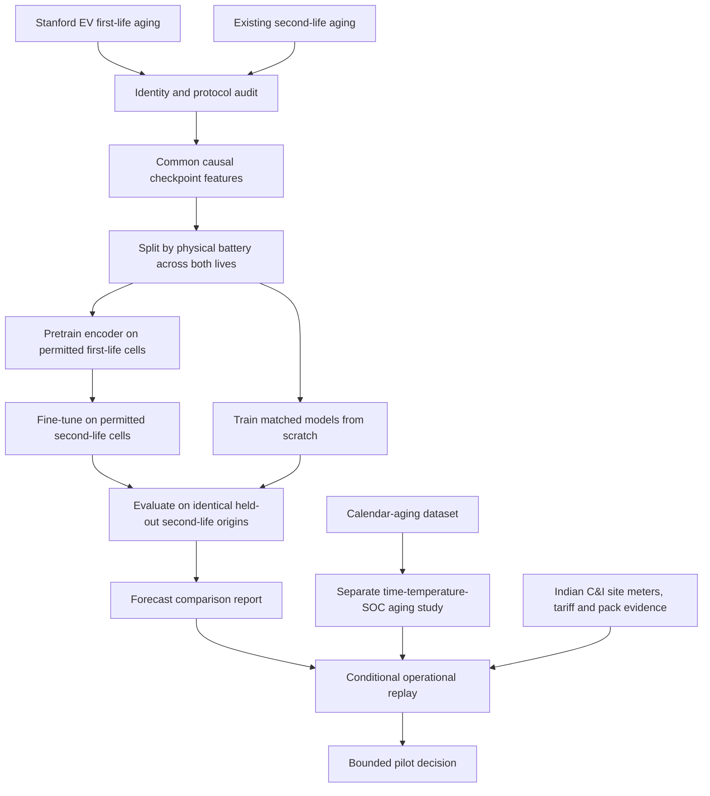

# ReCell dataset integration and validation plan

Planning date: 27 October 2026. Execution started as an active goal on the same date.
See the [source audit and execution status](transfer_source_audit.md): phase 14 is
complete, the phase 15 selective audit is complete, and phase 16 is blocked by
source-data quality failures after complete selective acquisition for v2.
A separately preregistered [v3 availability-restricted source-pool expansion](transfer_prefix_comparison.md)
now has verified features, a successful research smoke and a complete controlled
comparison, preserving all target batteries/origins. This is not a result for the
blocked full-history v2 protocol. Phases 1-13 remain the completed research prototype.
The separate
[calendar study](calendar_source_audit.md) has completed its preregistered
comparison, including material failures; phase-19 application and phase-20
validation gates remain open. The independent Indian public-building day-ahead
[load-forecast benchmark](india_public_data_audit.md#registered-day-ahead-load-comparison)
is complete; it does not close those controller, billing or field gates.
The subsequent [PV source/conversion review](india_pv_source_audit.md) prepares
an explicitly modeled public-benchmark PV input while retaining the measured-PV
and operational gates. The [target-temperature metadata audit](target_temperature_audit.md)
also leaves the physical sensor and calendar-application requirements open.
The [registered public-controller comparison](india_controller_review.md) is now
complete, with an unfavorable transfer-minus-scratch reference-score difference
of INR17.25 in its fixed 16-day scenario. It does not establish measured wear,
bills or field savings. The [requirement-by-requirement gate review](integration_gate_review.md)
records the remaining phase-19 application and phase-20 field/release requirements.

## 1. Research questions and scope

**Primary question:** Does first-life EV aging pretraining improve prediction of
second-life SOH for a physically unseen battery when only a short second-life
history is available?

**Separate downstream question:** Do better health forecasts lead to better storage
decisions under a credible aging model and Indian C&I operating conditions?

These need separate evidence. Lower forecast error does not establish lower measured
wear, longer life, investment payback or Indian site savings.

The first integration milestone is phases 14-18: Stanford EV first-life data plus
the existing second-life dataset. Calendar aging follows as a separate model in
phase 19. Indian C&I validation follows in phase 20. Parallel-module and LFP work
stay outside the first milestone.

## 2. Dataset integration map



| Dataset | Role | Priority | Boundary |
| --- | --- | --- | --- |
| Existing Stanford second-life grid-storage aging | Target task and reference benchmark | Retain | Six physical cells; not an independent new validation cohort |
| Stanford EV real-driving aging | Source pretraining and linked-life history audit | First | Ten reported cells include the earlier lives of the six target cells; usable histories and identity mapping still need inspection |
| Stanford calendar aging | Investigate calendar loss independently of the current throughput proxy | Second | Different cell types and storage protocols; do not concatenate into cycling training rows |
| Parallel-connected cell experiments | Later module-level imbalance and interconnection study | Deferred | Test conditions are not interchangeable with independent longitudinal aging trajectories |
| LFP SOC estimation / discharge characterization | Separate chemistry, SOC or measurement work | Deferred | Does not directly supply the current NMC second-life forecasting labels |

Source evidence: the [EV dataset paper](https://pmc.ncbi.nlm.nih.gov/articles/PMC8892076/)
describes ten M50T cells; the [second-life paper](https://pmc.ncbi.nlm.nih.gov/articles/PMC11639452/)
identifies its six cells as a subset. The [calendar-aging authors' repository](https://github.com/viveklam/Joule-Decade-Calendar-Aging)
documents diagnostic JSON summaries and storage-condition metadata. Raw file
compatibility has not yet been established.

## 3. Non-negotiable experiment boundaries

1. **Split physical batteries across all datasets and life stages.** Never train on
   a test battery's first life and call its second life an unseen-battery test.
2. **Separate validation from training.** Validation may select checkpoints under
   its declared role; it must not contribute gradient updates or scaler fitting.
3. **Keep first-life and second-life timestamps in order.** No future capacity,
   resistance, throughput or terminal metadata may enter an earlier forecast origin.
4. **Keep the historical benchmark reproducible.** New outputs go into separate
   directories. No overwrite of `data/processed/checkpoints.csv`, `outputs/lobo/`,
   `outputs/limited_history/`, `outputs/dispatch/` or the published reference snapshot.
5. **No fabricated predictors.** A missing EV duty category is not residential duty;
   an unavailable resistance measurement is not a measured zero.
6. **Independent cells are the statistical unit.** More rows, life stages or random
   seeds do not create more independent batteries.
7. **Test results do not select settings.** Lock the feature contract, primary
   endpoint, stopping rules and candidate methods before the transfer comparison.
   The existing benchmark is already familiar, so later independent validation is
   still required for a stronger generalization claim.

## 4. Phase 14 - Freeze the reference and register the comparison

Deliverables:

- Record hashes for current processed checkpoints, configs, folds, predictions,
  model artifacts and dashboard snapshot in a reference manifest.
- Save the code revision plus a patch/content manifest for uncommitted experiment
  code; a Git SHA alone is insufficient when the working tree has changes.
- Describe the target population, prediction origins, two-checkpoint model output,
  six outer test folds, three seeds and five context fractions.
- Register the proposed primary endpoint: equal-cell mean SOH RMSE at **10% context,
  horizon 1**, with source/target split and all comparisons fixed in advance.
- Register secondary endpoints: 25%, 50%, 75% and 100% contexts; horizon 2 and pooled
  horizons; MAE, R², interval coverage, width and pinball loss; per-cell failures.

Gate: historical inputs and results can be identified and the new comparison is
specified without overwriting them. This phase does not need model retraining.

## 5. Phase 15 - Acquire selectively; audit identities and protocols

Start with repository metadata, file listings, documented formats and a small
diagnostic/cycling sample. The original EV paper describes a very large raw
release; do not start by downloading the entire archive. Prefer a verified
processed-numeric release if it retains the signals and timestamps we need.

Record the selected version, file size, hashes, attribution/license and data
dictionary. Inspect MATLAB files as data rather than executing bundled scripts.
Keep raw material under a new dataset-specific directory.

Create a physical-cell registry with:

| Field | Purpose |
| --- | --- |
| `physical_cell_id` | Global identity spanning first and second life |
| `source_dataset`, `source_cell_id`, `life_stage` | Preserve original identity and campaign context |
| `chemistry`, `cell_model` | Establish material compatibility |
| `nominal_capacity_ah`, `nominal_capacity_basis` | Record the documented nominal convention |
| `identity_evidence`, `identity_status` | Cite the mapping; quarantine ambiguous matches |
| `protocol_id`, `capacity_test_method`, `resistance_test_method` | Distinguish measurement definitions |
| `source_hash`, `exclusion_reason` | Audit the accepted and rejected material |

Specific checks:

- Verify the mapping of G1, V4, V5, W8, W9 and W10 using publication and source
  metadata, not names alone. Audit the other reported cells for complete usable
  histories; do not assume all four add usable training trajectories.
- Check raw current sign, units, counter resets, sampling, timestamp conventions,
  duplicate exports and overlapping diagnostic windows independently for each source.
- The existing parser expects four accepted low-rate discharge segments within a
  capacity-with-pulses protocol. The EV release describes separate capacity/HPPC
  tests. It needs a protocol-specific adapter, not reuse of that four-segment rule.
- Verify whether processed MATLAB fields preserve diagnostic timestamps, current,
  voltage and cumulative exposure sufficiently for the planned features.
- Resolve nominal-capacity conventions. The existing dispatch uses a 5 Ah scenario
  reference; the EV paper lists a 4.85 Ah nominal specification. Record and justify
  the distinction without silently changing historical results.

Gate: a reviewed identity map, one reconstructed capacity trajectory and a
feature-availability report. Stop or reduce scope if the required information is
absent; no training until these checks pass.

## 6. Phase 16 - Build compatible features and battery-disjoint folds

### Common schema

Store checkpoint rows with global identity, source, life stage, protocol, checkpoint
start/end time, capacity Ah, reference capacity Ah, SOH, elapsed stage days,
stage-relative cumulative Ah, optional resistance, quality flags and source hashes.
Identity and protocol columns are audit/split keys, not default learned features.

**Recommended first feature contract:** three shared predictors: past SOH, elapsed
stage days and stage-relative cumulative Ah. Resistance is a separate, predeclared
ablation only if the acquisition audit establishes comparable measurements.

| Current feature | Integration decision |
| --- | --- |
| `soh` | Normalize each campaign to its first observed accepted capacity, available before its forecast origins. Retain raw Ah and reference values for auditing. Do not use future maxima. |
| `elapsed_days` | Days since the first accepted checkpoint of that life stage; preserve original dates separately. |
| `cumulative_ah` | Count causal charge-plus-discharge exposure using only cycling ending before the diagnostic begins. For the shared feature subtract the value available at the first stage checkpoint; retain original totals separately. |
| `pulse_resistance_ohm` | Exclude from the primary common feature set. Add only after auditing pulse duration, SOC, temperature, rest and calculation conventions. |
| `duty_commercial` | Omit from the first shared-feature comparison. EV operation must not be coded as residential. A later categorical EV/residential/commercial feature needs its own ablation. |
| `first_life_capacity_ah` | Omit from shared first-life pretraining. End-of-first-life capacity is future information at earlier first-life origins. Keep the original six-feature target benchmark as a reference. |

Never join histories across a life-stage boundary as one uninterrupted sequence.
The forecast target remains subsequent accepted checkpoints. Report the distribution
of elapsed days and Ah between targets in each domain: equal checkpoint horizons do
not imply equal forecast durations. The source head is reset before fine-tuning.

### Fold construction and preprocessing

For an outer fold with test cell G1 and validation cell V4:

- Target gradient training: second-life V5, W8, W9 and W10 only.
- Initial source gradient training: first-life histories of those same four cells.
- Validation: V4 under its declared stage-specific validation role, never gradient
  training or scaler fitting. Its first-life records may select the source
  checkpoint; its second-life records select the fine-tuned target checkpoint.
- Test: second-life G1 predictions only; G1 first-life records are excluded from all
  training, validation and preprocessing in this unseen-battery protocol.
- Additional verified physical cells from the EV release are a separately labelled
  source-pool expansion experiment, not silently included in the first comparison.

Fit one common imputer/scaler on unique **target training-cell checkpoints** within
the fold. Use that same fitted transform for source pretraining and both matched
target methods. This avoids changing the input coordinate system after transfer
and keeps the scratch/transfer comparison aligned. Audit source values that lie
outside target training ranges. This is fold-specific domain adaptation, not a
claim of universal source-only pretraining.

Gate: automated tests prove that global identities do not cross training,
validation or test roles; references and exposure are causal; feature order and
normalization contracts match; input hashes identify all source/target files.

## 7. Phase 17 - Add the smallest transfer-learning path

Reuse the existing GRU, ordered quantile head, losses, stopping rules and metric
functions. No new model family or dependency is needed for the first experiment.

1. Instantiate a new model with the common feature dimension. Existing six-input
   model weights must not be loaded into a three-input model.
2. Pretrain on permitted first-life sequences, selecting the checkpoint using only
   the declared source validation battery.
3. Transfer the GRU encoder and representation layers. Reinitialize the prediction
   head because life-stage target behavior and checkpoint spacing differ.
4. Reset the optimizer and learning-rate scheduler. Fine-tune all transferred layers
   on the permitted second-life training cells using the existing target validation
   rule. Frozen-encoder and learning-rate searches are deferred.
5. Fit matched from-scratch models with the same target feature transform, target
   data, architecture, seeds, target training budget and stopping rule.
6. Record source/target optimization time separately; extra pretraining compute must
   remain visible in the comparison.

Every transferred checkpoint must record source hashes, allowed physical cells,
features/order/units, scaler hash, architecture, quantile order, origin-relative
normalization, parent checkpoint and stage-specific validation identities. Reject
incompatible state dictionaries or changed provenance rather than partially loading
weights without an explicit contract.

Gate: one fold/seed smoke run passes, output quantiles are ordered, padding is
handled correctly, initialization is traceable and historical training remains
backward compatible.

## 8. Phase 18 - Run the controlled comparison

| Arm | Training | Purpose |
| --- | --- | --- |
| R0 | Existing six-feature results | Historical context; not the isolated estimate of transfer benefit |
| R1 | Common-feature PGP-GRU from scratch | Matched target-only reference |
| R2 | Common-feature PGP-GRU pretrained then fine-tuned | Primary transfer candidate |
| R3 | Common-feature quantile GRU from scratch | Remove physical penalties |
| R4 | Common-feature quantile GRU pretrained then fine-tuned | Separate transfer benefit from physical-penalty effects |
| R5 | Common-feature XGBoost | Strong matched non-recurrent baseline |
| R6 | Persistence at identical origins | Simple operational benchmark |

Train on full permitted histories, then evaluate the same target origins at context
fractions 10%, 25%, 50%, 75% and 100%, with seeds 42, 43 and 44. Cache or save each
fit once per fold/seed; changing inference context must not retrain the model.

Required report:

- Per-cell and aggregate metrics at each horizon/context. Average seeds within
  cells, then cells equally, as in the existing benchmark.
- Paired R2-minus-R1 RMSE differences as the primary transfer comparison; compare
  R2 with R4 for physical-guidance effects and with R5 for practical competitiveness.
- Coverage, width and pinball loss together, so wider intervals cannot masquerade
  as an unqualified improvement.
- Cell-level negative-transfer cases, recovery errors, source-target range shifts,
  exclusions, usable-cell counts, calendar-spacing differences and compute costs.
- Descriptive battery-level paired uncertainty intervals. Do not treat overlapping
  origins or seeds as independent observations or imply strong population evidence
  from six test cells.

Proposed interpretation rule: call a lower mean primary RMSE a directional transfer
benefit, report the full paired uncertainty and failure cases, and reserve a stronger
claim for consistent evidence plus independent validation. If the paired interval
includes zero, describe the result as inconclusive rather than proven superiority.
No minimum commercial acceptance threshold is invented here. The frozen protocol
must state the final scientific and pilot criteria before the new runs.

Gate: publish a positive, null or negative result honestly. If transfer fails, retain
the simpler model and investigate the mismatch without changing tests into tuning
data. Do not replace the client dashboard merely because a new model was trained.

## 9. Phase 19 - Calendar aging as a separate research track

Use the calendar dataset's diagnostic summaries and cell metadata to model loss
against elapsed storage time, temperature and SOC, with cell/type-disjoint testing.
Audit cell chemistry and storage ranges before any transfer to M50T second-life
operation. Resolve temperature channels in the target data first.

The current second-life observations and throughput-derived wear proxy already
reflect mixed calendar and cycling aging. Adding a fitted calendar term directly
to that proxy would risk double-counting. Establish an identifiable decomposition
or compare standalone alternatives; validate before combining them in dispatch.
Do not extrapolate accelerated high-temperature behavior to an Indian pack without
held-out evidence.

Gate: a separate calendar-model report, valid metadata, predictive validation and
an explicit accounting of what loss each component represents. No combined aging
model enters client savings claims until that gate passes.

## 10. Phase 20 - Indian C&I validation and conditional dashboard release

Required inputs: independent Indian interval demand and PV, tariff category and
DISCOM order, ToD slots, sanctioned demand/demand-charge rules, export agreement,
pack specifications and quotation, SOC/temperature/BMS measurements, and pilot
operating constraints. Define outage/backup requirements separately.

Evaluate candidate health forecasts under a matched controller, identical site
inputs and consistent wear accounting. Use realistic solar/load forecast errors
and eventually supervised closed-loop operation. Distinguish savings under an
assumed wear objective from measured battery aging and actual billed costs.

Existing `configs/india_ci.yaml` values remain labelled illustrative. The current
German household profile remains a proxy until replaced with reviewed site data.
Do not announce a deployment-ready C&I model from first-life transfer alone.

Dashboard release gate: input hashes match the new models and replay; model
selection is documented; reference and candidate runs are distinguishable; currency,
tariff exclusions, dataset identity and validation status are visible; published
claims match available evidence. Update the mathematical review PDF only after the
implemented equations or feature contract actually change.

## 11. Implementation touchpoints

The table below preserves the original implementation proposal. Current executed
paths and evidence are recorded in the [gate review](integration_gate_review.md);
the table is not a claim that every proposed path was used unchanged.

| Area | Reuse / change | Planned verification |
| --- | --- | --- |
| Acquisition and inventory | Reuse hashing, safe extraction and inspection helpers; add EV file listing and a dataset-specific adapter under `data/` | Hash/version integrity, unsafe paths rejected, selective sample acquisition |
| Parsing and targets | Reuse integration/counter helpers; new protocol-specific first-life preparation | Signs, units, capacity/counter agreement, timestamps, duplicate/conflicting records |
| Identity registry | New `configs/cell_registry.yaml` | Unknown/ambiguous identity quarantined; aliases map to one physical battery |
| Sequences and folds | Extend `data/sequences.py` and `training/cross_validation.py` for grouped multi-source identities and stage boundaries | No life-stage crossing, future features or physical-cell leakage |
| Model fitting | Small initialization path in `training/trainer.py`; reuse both GRU classes | Feature/scaler/architecture mismatch rejected; head reset and fresh optimizer verified |
| Experiment runner | Proposed `scripts/run_transfer_experiment.py` and `configs/transfer.yaml` | One-fold smoke test before the full matrix; immutable test-origin set |
| Provenance | Extend `utils/reproducibility.py` beyond its current hard-coded checkpoint path | All selected datasets, registry, folds, config, parent weights and transforms hashed |
| Reporting | Reuse `evaluation/metrics.py`; parameterize analysis inputs rather than overwrite reference paths | Equal-cell aggregation, matched pairs, missing intervals stay unavailable |
| Dashboard | Conditional adapter/export update after phase 18/20 gates | No silent candidate promotion or mixed reference/candidate provenance |

Proposed separate artifacts:

```text
data/raw/stanford_ev_first_life/           # selected verified source release
data/processed/transfer/                  # harmonized tables and quality reports
outputs/transfer/source_audit/            # identity, protocol and availability audit
outputs/transfer/<protocol-id>/           # folds, fits, predictions and results
outputs/calendar/<protocol-id>/           # later, separate calendar experiment
```

Preserve the existing pipeline's defaults. This does not require a general-purpose
dataset registry service, new database, model platform or dependency stack.

## 12. Initial work package (historical planning scope)

The initial work package started with phases 14-15 only:

1. Freeze the current reference manifest and write the experiment protocol.
2. Inventory the EV repository metadata and inspect representative diagnostic and
   cycling files; establish format and storage requirements.
3. Draft and verify the physical-cell mapping and protocol comparison.
4. Reconstruct one sample cell's capacity/exposure trajectory and publish the
   feature-compatibility report with exclusions.
5. Use the evidence to finalize the shared-feature contract before implementing the
   transfer runner or launching full training.

Completion of that initial package means a reviewable audit with a clear go/no-go for the transfer
experiment. Runtime and full-download estimates follow that audit; no unsupported
completion date or guaranteed accuracy gain is assumed.
This is not the completion criterion for the active phases 14-20 goal; its full
calendar-application, Indian site-validation and conditional release gates remain
as specified above.
